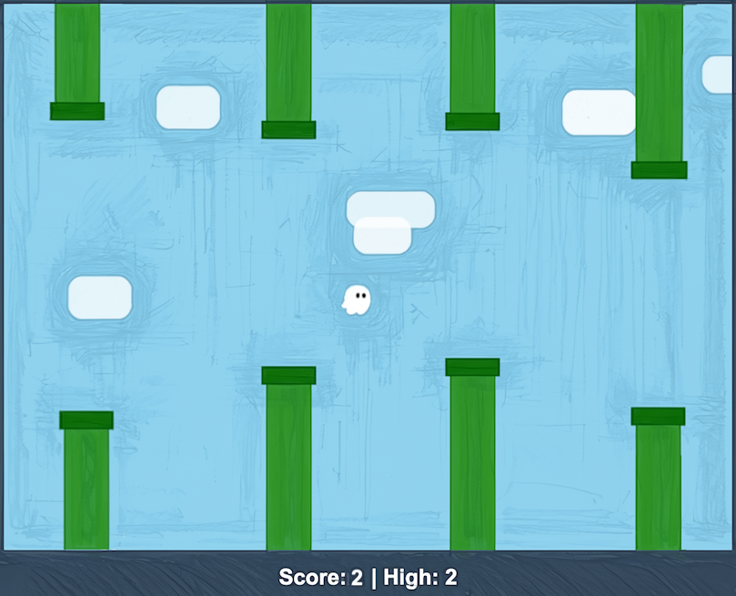

# 👻 Flappy Kiro

Juego tipo *Flappy Bird* con un fantasma como protagonista, creado con **Kiro**, el editor de código con IA de AWS, a partir del kit de arranque que nos dieron en una convención de **AWS**.

> ✅ **Estado:** juego completo y jugable.

## 🎮 El juego



El objetivo es sencillo: **mantener a Ghosty en el aire y pasar por los huecos de las tuberías sin chocar**. Cada tubería superada suma un punto.

| Elemento | Qué hace |
| :--- | :--- |
| 👻 **Ghosty** | El personaje. Cae por la gravedad y **sube cada vez que saltas** |
| 🟩 **Tuberías** | Se mueven de derecha a izquierda, con un hueco a una altura distinta cada vez |
| 💥 **Colisión** | Tocar una tubería o el suelo termina la partida y suena `game_over.wav` |
| 🔢 **Score** | Puntos de la partida actual (+1 por cada tubería superada) |
| 🏆 **High** | Mejor puntuación conseguida |
| 🔊 **Sonidos** | `jump.wav` en cada salto y `game_over.wav` al perder |

## 🕹️ Controles

| Acción | Tecla |
| :--- | :--- |
| Saltar | `Espacio` o clic del ratón |
| Reiniciar tras perder | `Espacio` o clic |

## ▶️ Cómo jugar

1. Clonar el repositorio:
   ```bash
   git clone https://github.com/EduardoFafianMontero/Kiro-app.git
   cd Kiro-app
   ```
2. Abrir `index.html` en el navegador (doble clic sobre el archivo).
3. Pulsar `Espacio` para empezar.

No hay que instalar nada.

## 📂 Estructura del repositorio

```
Kiro-app/
├── assets/                           ← recursos del juego
│   ├── ghosty.png                    ← sprite del fantasma
│   ├── jump.wav                      ← sonido de salto
│   └── game_over.wav                 ← sonido de fin de partida
├── img/
│   └── example-ui.png                ← captura del juego
├── index.html                        ← página y lienzo del juego
├── (código del juego)                ← lógica: gravedad, tuberías, colisiones, puntuación
├── kiro-introduction-starter-kit.zip ← kit original de AWS
├── .gitignore                        ← archivos que Git no sube
├── LICENCE.md                        ← licencia MIT-0
└── README.md                         ← este archivo
```

## ⚙️ Cómo funciona por dentro

El juego sigue un **bucle** que se repite unas 60 veces por segundo:

1. **Actualizar:** la gravedad tira de Ghosty hacia abajo y las tuberías avanzan hacia la izquierda.
2. **Comprobar colisiones:** se mira si Ghosty toca una tubería, el suelo o el techo.
3. **Puntuar:** si una tubería queda detrás de Ghosty, suma 1 punto.
4. **Dibujar:** se pinta el fondo, las tuberías, a Ghosty y el marcador.

Conceptos que usa:

| Concepto | Para qué sirve |
| :--- | :--- |
| **Gravedad y velocidad** | Ghosty cae cada vez más rápido y el salto le da un impulso hacia arriba |
| **Colisión por rectángulos** | Ghosty y las tuberías se tratan como cajas; si se solapan, hay choque |
| **Aleatoriedad** | La altura de cada hueco se elige al azar |
| **Estados del juego** | Esperando, jugando y fin de partida |

## 🧩 Recursos

| Archivo | Tipo | Función |
| :--- | :--- | :--- |
| `assets/ghosty.png` | PNG | Sprite del personaje |
| `assets/jump.wav` | WAV | Efecto al saltar |
| `assets/game_over.wav` | WAV | Efecto al perder |
| `img/example-ui.png` | PNG | Captura del juego |

## 🛠️ Tecnologías

- **Kiro**: editor con IA de AWS usado para crear el juego.
- **HTML, CSS y JavaScript**: la página y la lógica, con `<canvas>`.
- **Git y GitHub**: control de versiones.

## 💡 Qué aprendí

- Cómo describir un proyecto a una IA y revisar lo que genera.
- Cómo funciona un bucle de juego.
- Cómo se detectan colisiones.
- Cómo organizar un repositorio con recursos, código y documentación.

## 🗺️ Mejoras posibles

- [ ] Dificultad creciente: tuberías más rápidas con la puntuación
- [ ] Guardar `High` en el navegador (`localStorage`)
- [ ] Pantalla de inicio y botón de pausa
- [ ] Versión para móvil con control táctil
- [ ] Publicarlo con GitHub Pages para jugar desde un enlace

## 📄 Licencia

Recursos del kit bajo **MIT-0**, de Amazon (ver [`LICENCE.md`](./LICENCE.md)).
